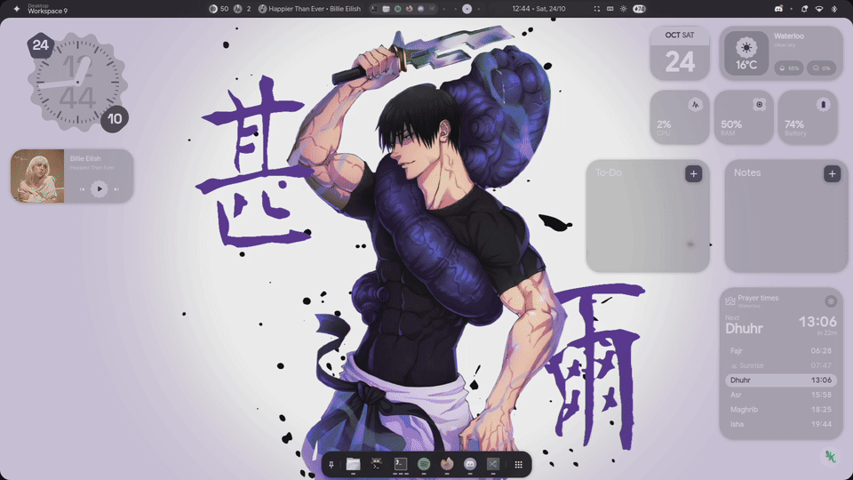
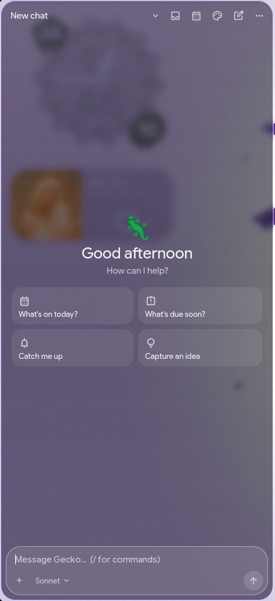
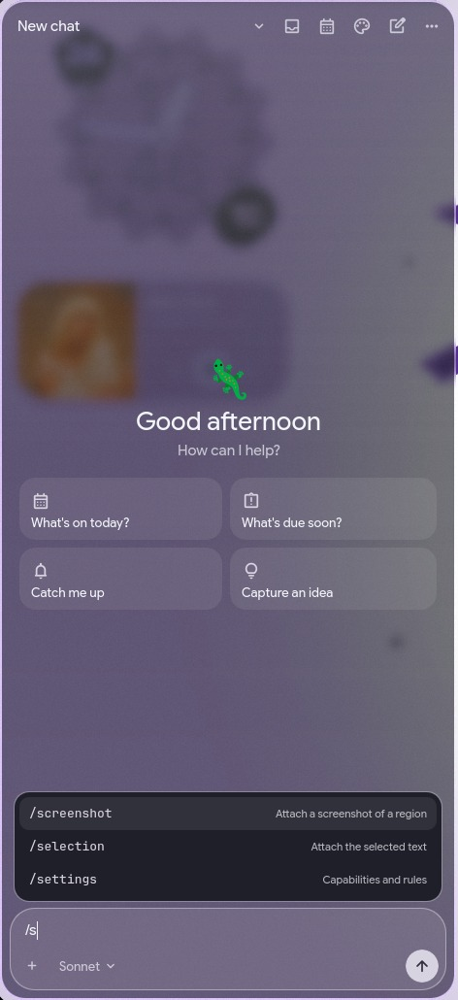
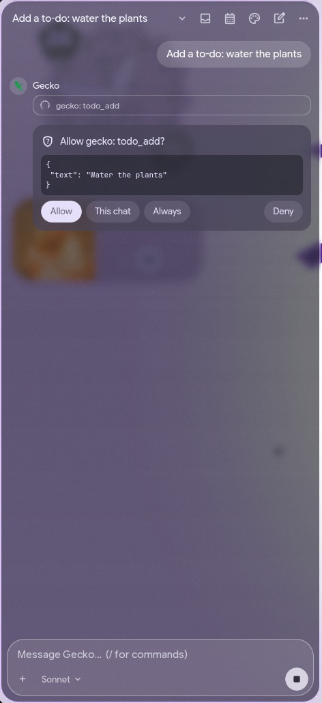
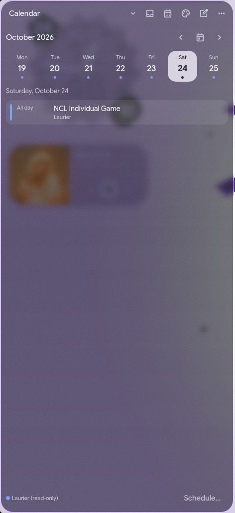
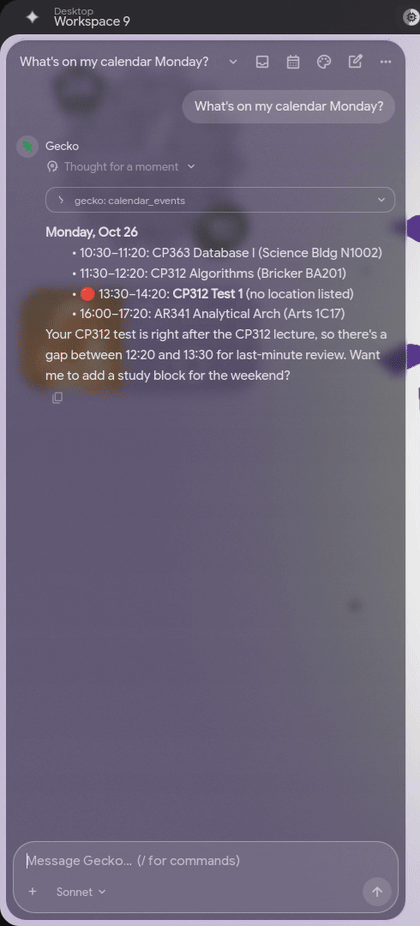
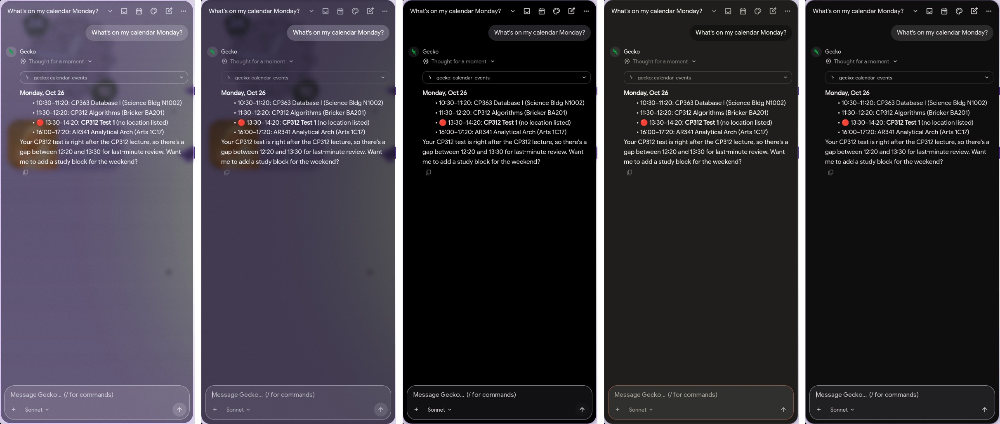

# Gecko's Helper

A desktop agent for the [end-4 / illogical-impulse](https://github.com/end-4/dots-hyprland)
Hyprland shell. It drives the coding-agent CLIs you already pay for (Claude Code
first; Codex and OpenCode planned) instead of API keys. It gives them safe,
toggleable access to your desktop: to-dos, notifications, calendar, Obsidian
vault, media and system info.

> Status: **early but usable**. The panel (Super+A), the daemon, the desktop MCP server,
> the context generator and a terminal client work. See the roadmap.



<sub>Full-quality video: [main.mp4](docs/media/main.mp4)</sub>

| Start | / commands | Approvals | Calendar |
|:-:|:-:|:-:|:-:|
|  |  |  |  |

**Quick ask** on Super+Space, from anywhere: `/todo` lands on the desktop to-do widget at once, a question opens the panel with the answer.


<sub>[quickask.mp4](docs/media/quickask.mp4)</sub>

**Themes in Lua**, switched with Ctrl+T or the palette button: glass, midnight, blur, claude and default (follows your wallpaper).

<p align="center"></p>



## The panel

`qs -c gecko`, a separate Quickshell config that reuses end-4's own widgets and
wallpaper colors through symlinks, so it looks native but end-4 updates never
overwrite it. It replaces end-4's left sidebar on **Super+A** and on the bar's ✦ AI
button (right-click the button, or Super+B / Super+O, for end-4's own sidebar).

Works with the desktop widgets from [Gecko's dots](https://github.com/thegeekyqazi/geckos-dots):
the to-do and notes widgets share Gecko's files, and the calendar widget reads the
shared feed `~/.local/state/geckos-helper/calendar.json` (refreshed every 10 minutes)
to show your events.

- Streaming replies with markdown, collapsible tool cards, "thinking" blocks
- Permission cards: **Allow**, **Allow for this chat**, **Deny**
- **Attachments** (the **+** button): screenshot a region, the focused window, the clipboard,
  selected text, or a file. Images go to the model as images; text is marked untrusted.
- **/ commands** with a palette (↑↓, Tab, Enter): `/todo`, `/note`, `/idea` act instantly
  without the AI; `/screenshot`, `/window`, `/clipboard`, `/selection`, `/file` attach;
  `/remember`, `/model`, `/theme`, `/briefing`, `/handoff`, `/copy`, page shortcuts, `/kill`.
- **Quick ask** on **Super+Space**: a small box in the middle of the screen; Enter starts a
  chat, and / commands work there too.
- Model picker in the composer; the star sets the default for new chats (Sonnet out of the box)
- **Themes in Lua** with live reload and a theme switcher button; see [docs/THEMES.md](docs/THEMES.md)
- **Projects** page: your vault's projects and goals with progress and next task, plus your ideas list
- **Inbox** for recipe reports (the daily briefing arrives at 8:00), with an unread badge
- **Activity** page: everything Gecko did, who approved it, watchers and recipes
- **Memory** page: what Gecko remembers (Claude Code's own memory), plus search across all chats
- **Mascot** in a screen corner: idle, working, or a badge when an approval is waiting (click it)
- **Hand-off**: copy a chat, or a short model-written brief, to paste into Claude.ai
  (panel menu, `gecko handoff [--brief]`, or just ask Gecko to hand it off)
- Chat history, capability switches, kill switch, 5-hour / 7-day usage bars
- Ctrl+N new chat, Ctrl+H history, Ctrl+T next theme, Ctrl+O wider panel, Esc closes
- `qs -c gecko ipc call gecko ask "..."` sends a prompt from a script or keybind

## How it fits together

```
┌──────────────┐  unix socket  ┌─────────────────────────┐  stream-json  ┌────────────┐
│  Quickshell  │ ◄───────────► │  gecko daemon (systemd) │ ◄───────────► │ claude -p  │
│  sidebar UI  │   JSON lines  │  • chats & history      │               │ (codex,    │
│  gecko chat  │               │  • permission prompts   │               │  opencode) │
└──────────────┘               │  • kill switch          │               └─────┬──────┘
                               └─────────────────────────┘                     │ MCP (stdio)
                                                               ┌───────────────▼──────────┐
                                                               │ gecko MCP server         │
                                                               │ todo · notifications ·   │
                                                               │ calendar · obsidian ·    │
                                                               │ media · system · handoff │
                                                               └──────────────────────────┘
```

- **Separate profile.** The agent runs in `~/.local/share/geckos-helper/workspace`,
  so its chat history doesn't mix with your normal Claude Code sessions. It gets
  its own settings (`~/.config/geckos-helper/claude-settings.json`, layered on top
  of yours with `--settings`) and a system prompt that is *appended* to Claude
  Code's (`--append-system-prompt-file`), never replacing it. Set
  `inherit_settings = false` to stop loading your `~/.claude` settings, hooks
  and CLAUDE.md.
- **Permission prompts go to you.** Claude runs with `--permission-prompt-tool stdio`, so
  every "may I run this?" comes to the daemon and on to the UI as an
  approve/deny request. The read-only desktop tools are pre-approved in the
  profile settings; anything that writes asks first.
- **Context file.** `gecko context` writes a short, hand-picked description of
  this machine: installed tools from [`profile/tools.toml`](src/geckos_helper/profile/tools.toml),
  MCP servers, skills, disabled capabilities, and what's new this week. A daily
  systemd timer regenerates it.
- **Event names follow ACP.** Backends translate each CLI's output into
  [Agent Client Protocol](https://agentclientprotocol.com) session-update events,
  so ACP agents (`opencode acp`, codex-acp) can be added without UI changes.

## Security model

- **Notifications, calendar entries, clipboard, web pages and files are data, not
  instructions.** MCP tools wrap third-party text in `<untrusted-content>`, and
  the system prompt tells the agent never to act on it. Nothing runs automatically
  because a notification arrived.
- **Per-capability toggles:** `gecko caps <name> on|off`. Every tool checks its
  toggle on every call, so turning one off takes effect mid-chat. Clipboard
  reading is off by default.
- **Kill switch:** `gecko kill on` stops every running agent and blocks all
  desktop tools, even if the daemon is down. Bind it to a key in
  `~/.config/hypr/custom/keybinds.lua`:
  `hl.bind("SUPER+ALT+K", hl.dsp.exec_cmd("~/.local/bin/gecko kill toggle"), {description = "Gecko kill switch"})`
- **Action log:** every write a tool makes is appended to
  `~/.local/state/geckos-helper/actions.jsonl`.
- **No retry loops:** after you deny an action, an identical request in the same
  turn is denied automatically and the agent is told not to work around it.
- **"This chat"** remembers the tool for that chat only; for shell commands it
  remembers the exact command, never a whole program.
- **"Always"** saves a rule to `~/.config/geckos-helper/permission-rules.json`:
  glob patterns like `Bash:git status*`, allow or deny, last match wins.
- **Injection guard**: every tool result is scanned for prompt-injection patterns
  (borderline third-party content gets a Haiku second opinion). A hit shows a red
  card and taints the chat: saved "allow" rules and "this chat" approvals pause, and
  every action needs your approval with a warning, until you clear it.
- **Unattended runs are read-only** (watchers now, recipes later): web search, web
  fetch only for domains the watcher lists, Gecko's read-only tools, no shell or
  file edits, nothing prompted (`dontAsk`), only the gecko MCP server, which itself
  runs with `GECKO_READONLY=1` and refuses writes. Results are guard-scanned before
  they reach your notifications.

## Install

Requires [uv](https://docs.astral.sh/uv/), Python 3.14 and Claude Code logged in.

```sh
./install.sh          # installs `gecko`, the panel, keybinds, end-4 add-ons and systemd units
gecko chat            # talk to it in the terminal
gecko ask "what's due this week in my vault?"
gecko caps            # list capability toggles
gecko model opus --default   # or pick it in the panel
gecko kill toggle
gecko end4-patch      # re-apply the end-4 add-ons after an end-4 update
./uninstall.sh        # removes everything it added, keeps your data
```

Config lives in `~/.config/geckos-helper/config.toml` (agent path, model,
Obsidian vault, calendar feeds).

### Calendar

Calendars are read from `.ics` feeds. For a Microsoft 365 / Outlook calendar
(e.g. a university account), publish it from Outlook on the web
(Settings › Calendar › Shared calendars › Publish a calendar) and add the ICS link:

```toml
[[calendar.ics]]
name = "University"
url = "https://outlook.office365.com/owa/calendar/.../calendar.ics"
```

### Google Calendar (read and write)

Gecko talks to Google with your own OAuth client, so nothing goes through a
third-party server. One-time setup (about 10 minutes):

1. Open [console.cloud.google.com](https://console.cloud.google.com), create a project (e.g. "Gecko").
2. **APIs & Services › Library**: enable **Google Calendar API**.
3. **Google Auth Platform** (OAuth consent screen): app name "Gecko", audience
   **External**, your Gmail as support and developer contact.
4. **Audience**: add your Gmail as a **test user**. Then **Publish app**: in
   "Testing" mode Google expires the login every 7 days. Publishing a personal app
   doesn't need review; you'll just see an "unverified app" screen at sign-in
   (Advanced › Go to Gecko).
5. **Clients › Create client › Desktop app**, then download the JSON and save it as
   `~/.config/geckos-helper/google-client.json`.
6. Run `gecko calendar login`, sign in in the browser, and check with `gecko calendar list`.

New events go to your primary Google calendar unless you set `write_to` under
`[calendar.google]`. The Laurier feed stays read-only; when something belongs
there, Gecko gives you the details to add in Outlook.

## Roadmap

- [x] Daemon, Claude Code backend, permission round-trip, chat resume
- [x] Desktop MCP server, capability toggles, kill switch, action log
- [x] Context file generator + daily timer
- [x] Quickshell panel on Super+A with tool cards, approve/deny, history, model picker, usage meter
- [x] end-4 to-do widget picks up agent edits (small re-appliable patch)
- [x] Chat-app redesign, Lua themes with live reload, theme switcher, context hand-off
- [x] "Always allow" permission rules, editable in settings
- [x] Activity page: audit trail of everything Gecko did and what's scheduled
- [x] Memory: Claude Code's own memory, viewable/editable in the panel, plus search across past chats
- [x] Watchers: read-only background checks that notify you ("tell me if it'll rain before class")
- [x] Desktop mascot showing idle / working / needs-approval
- [x] Calendar layer (ICS + Google read/write), clash check, calendar page in the panel
- [ ] DavMail / CalDAV provider for Outlook writes, only if Laurier ICT approves
- [x] Safety: injection guard with chat tainting, read-only profile for unattended runs
- [x] Recipes (TOML) on schedules and event triggers, inbox, usage budget, daily briefing; see [docs/RECIPES.md](docs/RECIPES.md)
- [x] Obsidian projects, goals and ideas in your note style, hub table, project check-ins, one-click suggested to-dos; see [docs/PROJECTS.md](docs/PROJECTS.md)
- [x] Attachments (screenshot, window, clipboard, selection, file), / commands, quick ask on Super+Space

## Future ideas

Collected from similar projects (Meta Muse, Hermes Agent, OpenClaw, Goose, Mofakir,
Newelle, Raycast). Not scheduled yet.

- **Approvals from your phone**: approval requests and results sent through ntfy or Telegram, so background work doesn't wait for you to be at the laptop
- **Self-written skills**: a "save as recipe" button that turns a task that went well into a reusable skill
- **Credential vault**: logins kept in the system keyring, usable by tools but never readable by the agent
- **Cheap-model routing**: simple questions go to Haiku and harder ones to Sonnet automatically
- **Push-to-talk voice**: local speech-to-text (whisper.cpp) and optional spoken replies
- **Text-selection actions**: select text anywhere, press a key: explain, translate, summarize, make a to-do
- **Study mode**: quizzes and flashcards generated from Obsidian course notes before a test
- **D2L / Brightspace sync**: assignments and deadlines from the D2L scraper into the calendar and to-dos
- **Projects**: chats grouped per course or project, each with its own instructions and files
- **Codex and OpenCode** as agents, through ACP (`opencode acp`, codex-acp); the daemon's events already use ACP names
- **Focus mode**: during class (from the calendar), hold non-urgent notifications and summarize them afterwards

## License

MIT
