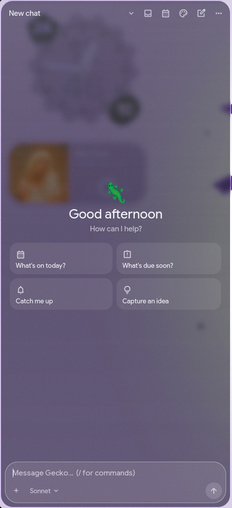
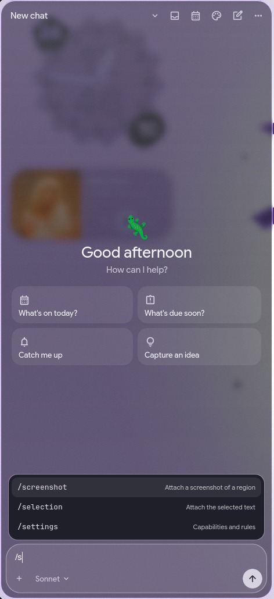
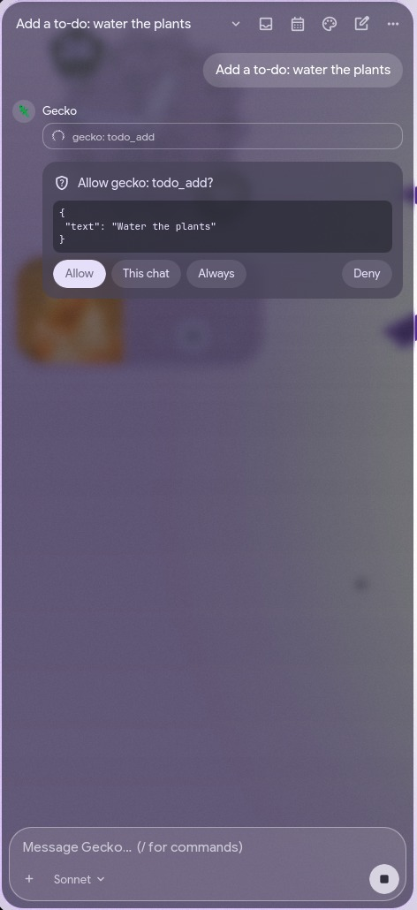
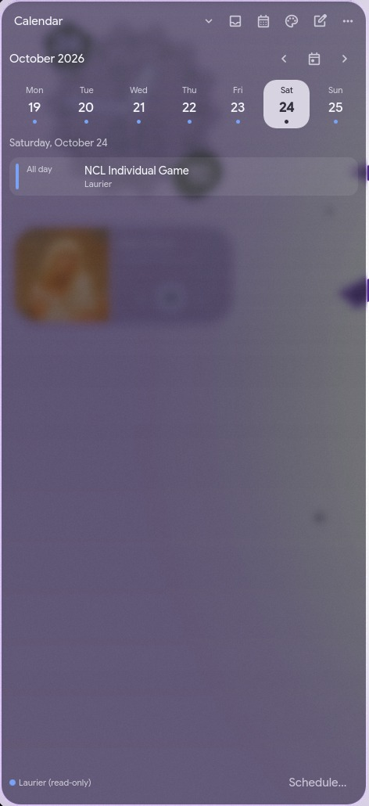
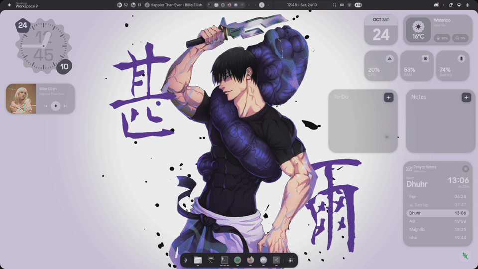
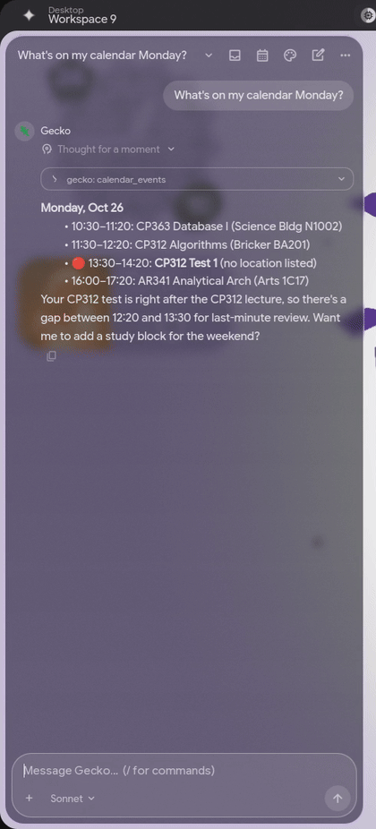
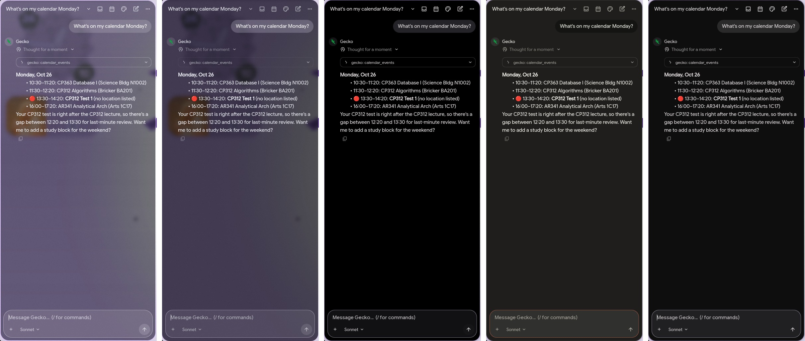

# Gecko's Helper

**A desktop agent that runs on Claude Code with your subscription as the backend.
No API key needed. Made for [end-4](https://github.com/end-4/dots-hyprland).**

Gecko lives in a panel on your Hyprland desktop (Super+A) and drives the agent CLI
you already pay for, so it works on your Claude plan instead of per-token API
billing. It gets safe, toggleable access to your desktop: calendar, to-dos and
notes, notifications, Obsidian vault, media and system info. Codex and OpenCode
support is planned.

> Status: **early but usable**. The panel (Super+A), the daemon, the desktop MCP server,
> the context generator and a terminal client work. See the roadmap.


<sub>Full-quality video: [main.mp4](docs/media/main.mp4)</sub>

| Start | / commands | Approvals | Calendar |
|:-:|:-:|:-:|:-:|
|  |  |  |  |

**Quick ask** on Super+Space, from anywhere: `/todo` lands on the desktop to-do widget at once, a question opens the panel with the answer.



<sub>[quickask.mp4](docs/media/quickask.mp4)</sub>

**Themes in Lua**, switched with Ctrl+T or the palette button: glass, midnight, blur, claude and default (follows your wallpaper).

<p align="center"></p>



## The panel

`qs -c gecko`, a separate Quickshell config that reuses end-4's own widgets and
wallpaper colors through symlinks, so it looks native but end-4 updates never
overwrite it. It replaces end-4's left sidebar on **Super+A** and on the bar's ✦ AI
button (right-click the button, or Super+B / Super+O, for end-4's own sidebar).

Works on its own with end-4. **Optionally** pairs with the desktop widgets from
[Gecko's dots](https://github.com/thegeekyqazi/geckos-dots):
the to-do and notes widgets share Gecko's files, and the calendar widget reads the
shared feed `~/.local/state/geckos-helper/calendar.json` (refreshed every 10 minutes)
to show your events. What the two share: [docs/INTEGRATION.md](docs/INTEGRATION.md).

- Streaming replies with markdown, collapsible tool cards, "thinking" blocks
- Permission cards: **Allow**, **Allow for this chat**, **Deny**
- **Attachments** (the **+** button): screenshot a region, the focused window, the clipboard,
  selected text, or a file. Images go to the model as images; text is marked untrusted.
- **/ commands** with a palette (↑↓, Tab, Enter): `/todo`, `/note`, `/idea` act instantly
  without the AI; `/screenshot`, `/window`, `/clipboard`, `/selection`, `/file` attach;
  `/remember`, `/model`, `/theme`, `/briefing`, `/handoff`, `/copy`, page shortcuts, `/kill`.
- **Quick ask** on **Super+Space**: a small box in the middle of the screen; Enter starts a
  chat, and / commands work there too.
- Model picker in the composer; the star sets the default for new chats (Sonnet out of the box)
- Permission mode picker below the composer; **Settings → Permissions** sets the default
  for new chats. `/permissions` opens those settings.
- **Themes in Lua** with live reload and a theme switcher button; see [docs/THEMES.md](docs/THEMES.md)
- **Projects** page: your vault's projects and goals with progress and next task, plus your ideas list
- **Inbox** for recipe reports (the daily briefing arrives at 8:00), with an unread badge
- **Activity** page: everything Gecko did, who approved it, watchers and recipes
- **Memory** page: what Gecko remembers (Claude Code's own memory), plus search across all chats
- **Mascot** in a screen corner: idle, working, or a badge when an approval is waiting (click it)
- **Continue in another AI chat**: preview and edit a model-written brief for Claude.ai,
  ChatGPT or another chat before copying. Includes stored tool evidence, missing-file
  notices and recipient access limits; files/images must be uploaded separately.
  “Copy chat” exports the stored transcript. CLI: `gecko handoff [--brief] [--preview]`.
- Chat history, capability switches, kill switch, 5-hour / 7-day usage bars
- Ctrl+N new chat, Ctrl+H history, Ctrl+T next theme, Ctrl+O wider panel, Ctrl+Plus/Minus text size (Ctrl+0 resets), Esc closes
- **Settings → Display** has separate saved panel width and text size (70–200%) controls
  and resets. Drag the inner edge to resize width; the full-height panel stays within
  the screen. Existing zoom settings keep their previous apparent width on upgrade.
- Scroll up to read without incoming replies pulling you down; “Jump to latest” resumes.
  Approval cards offer full selectable details and wrap their action buttons at large sizes.
- `qs -c gecko ipc call gecko ask "..."` sends a prompt from a script or keybind

## How it fits together

```
┌──────────────┐  unix socket  ┌─────────────────────────┐  stream-json  ┌────────────┐
│  Quickshell  │ ◄───────────► │  gecko daemon (systemd) │ ◄───────────► │ claude -p  │
│  sidebar UI  │   JSON lines  │  • chats & history      │               │ (codex,    │
│  gecko chat  │               │  • permission prompts   │               │  opencode) │
└──────────────┘               │  • kill switch          │               └─────┬──────┘
                               └─────────────────────────┘                     │ MCP (stdio)
                                                               ┌───────────────▼──────────┐
                                                               │ gecko MCP server         │
                                                               │ todo · notifications ·   │
                                                               │ calendar · obsidian ·    │
                                                               │ media · system · handoff │
                                                               └──────────────────────────┘
```

- **Separate profile.** The agent runs in `~/.local/share/geckos-helper/workspace`,
  so its chat history doesn't mix with your normal Claude Code sessions. It gets
  its own settings (`~/.config/geckos-helper/claude-settings.json`, layered on top
  of yours with `--settings`) and a system prompt that is *appended* to Claude
  Code's (`--append-system-prompt-file`), never replacing it. Set
  `inherit_settings = false` to stop loading your `~/.claude` settings, hooks
  and CLAUDE.md.
- **Permission prompts go to you.** Claude runs with `--permission-prompt-tool stdio`, so
  every "may I run this?" comes to the daemon and on to the UI as an
  approve/deny request. The read-only desktop tools are pre-approved in the
  profile settings; in Manual mode, other actions use Claude Code's approval checks.
- **Context file.** `gecko context` writes a short, hand-picked description of
  this machine: installed tools from [`profile/tools.toml`](src/geckos_helper/profile/tools.toml),
  MCP servers, skills, disabled capabilities, and what's new this week. A daily
  systemd timer regenerates it.
- **Event names follow ACP.** Backends translate each CLI's output into
  [Agent Client Protocol](https://agentclientprotocol.com) session-update events,
  so ACP agents (`opencode acp`, codex-acp) can be added without UI changes.

## Security model

### Permission modes

The picker uses [Claude Code's native permission modes](https://code.claude.com/docs/en/permissions).
Each chat saves its own choice. Stop a running turn before changing it; an idle agent
closes and resumes with the selected mode on the next message. Changing the default
does not alter existing chats. The initial default stays Manual.

| Picker | Native mode | Behavior |
|---|---|---|
| Manual | `default` / `manual` | Normal approval prompts |
| Accept edits | `acceptEdits` | Accept edits and common filesystem operations in working directories |
| Plan | `plan` | Native planning and exploration behavior |
| Auto | `auto` | Claude's classifier reviews actions; requires backend/model/account support |
| Don't ask | `dontAsk` | Deny calls that need approval; native preapproved actions still run |
| Full access | `bypassPermissions` | Skip native checks, including protected-path writes |

There is no silent fallback if Claude rejects a mode. Its error appears in the chat.
The canonical `default` choice is passed to current Claude Code as `manual`.

Like [Codex's permissions control](https://developers.openai.com/codex/agent-approvals-security),
the picker keeps approval behavior visible. **Gecko currently runs Claude Code only:**
it does not implement Codex's independent `read-only`, `workspace-write` or
`danger-full-access` OS sandboxes, nor Codex's approval reviewer. Auto uses Claude's
actual classifier, not an unconditional Gecko approval rule.

Full access permits actions without the usual review. Gecko's saved rules can gate
only requests Claude sends to the host; native auto-approved calls do not pass through
that gate. Separately, a detected guard warning stops the affected chat and blocks
further messages until you explicitly review and clear it, in every permission mode.
Native Claude settings and managed policies still apply.
Capability switches constrain Gecko integrations, not shell/file tools or other MCP
servers. The kill switch remains available. Background watchers and recipes keep their
separate restricted, read-only profile regardless of chat/default mode.

```sh
gecko permissions                           # show modes and default
gecko permissions acceptEdits --default     # new chats only
gecko permissions plan --chat CHAT_ID       # idle existing chat
gecko permissions bypassPermissions --chat CHAT_ID
gecko permissions default --default         # restore Manual for new chats
```

### Gecko tool controls

- **Notifications, calendar entries, clipboard, web pages and files are data, not
  instructions.** MCP tools wrap third-party text in `<untrusted-content>`, and
  the system prompt tells the agent never to act on it. Nothing runs automatically
  because a notification arrived.
- **Per-capability toggles:** `gecko caps <name> on|off`. Every tool checks its
  toggle on every call, so turning one off takes effect mid-chat. Clipboard
  reading is off by default.
- **Kill switch:** `gecko kill on` stops every running agent and blocks all
  desktop tools, even if the daemon is down. Bind it to a key in
  `~/.config/hypr/custom/keybinds.lua`:
  `hl.bind("SUPER+ALT+K", hl.dsp.exec_cmd("~/.local/bin/gecko kill toggle"), {description = "Gecko kill switch"})`
- **Action log:** every write a tool makes is appended to
  `~/.local/state/geckos-helper/actions.jsonl`.
- **No retry loops:** after you deny an action, an identical request in the same
  turn is denied automatically and the agent is told not to work around it.
- **"This chat"** remembers the tool for that chat only; for shell commands it
  remembers the exact command, never a whole program.
- **"Always"** saves a rule to `~/.config/geckos-helper/permission-rules.json`:
  glob patterns like `Bash:git status*`, allow or deny, last match wins. New one-click
  rules match the tool's exact arguments. Existing broad rules remain broad until
  removed in Settings.
- **Injection guard**: every tool result is scanned for prompt-injection patterns
  (borderline third-party content gets a Haiku second opinion). A hit shows a red
  card, force-stops that chat's agent process group and blocks further messages until
  you explicitly review and clear it. Auto, Full access and saved allows cannot bypass
  this review block. Clearing keeps your selected mode and resumes on your next message.
  Scanning follows tool output, so actions started before detection cannot be undone.
  Ordinary autonomy wording such as "without asking the user" is a weak signal, not
  sufficient on its own to label a local file as injection or concealment.
- **Unattended runs are read-only** (watchers now, recipes later): web search, web
  fetch only for domains the watcher lists, Gecko's read-only tools, no shell or
  file edits, nothing prompted (`dontAsk`), only the gecko MCP server, which itself
  runs with `GECKO_READONLY=1` and refuses writes. Results are guard-scanned before
  they reach your notifications.

## Install

Requires [uv](https://docs.astral.sh/uv/), Python 3.14 and Claude Code logged in.

```sh
./install.sh          # installs `gecko`, the panel, keybinds, end-4 add-ons and systemd units
gecko chat            # talk to it in the terminal
gecko ask "what's due this week in my vault?"
gecko caps            # list capability toggles
gecko model opus --default   # or pick it in the panel
gecko kill toggle
gecko end4-patch      # re-apply the end-4 add-ons after an end-4 update
./uninstall.sh        # removes everything it added, keeps your data
```

Config lives in `~/.config/geckos-helper/config.toml` (agent path, model,
Obsidian vault, calendar feeds).

### Calendar

Calendars are read from `.ics` feeds. For a Microsoft 365 / Outlook calendar
(e.g. a university account), publish it from Outlook on the web
(Settings › Calendar › Shared calendars › Publish a calendar) and add the ICS link:

```toml
[[calendar.ics]]
name = "University"
url = "https://outlook.office365.com/owa/calendar/.../calendar.ics"
```

### Google Calendar (read and write)

Gecko talks to Google with your own OAuth client, so nothing goes through a
third-party server. One-time setup (about 10 minutes):

1. Open [console.cloud.google.com](https://console.cloud.google.com), create a project (e.g. "Gecko").
2. **APIs & Services › Library**: enable **Google Calendar API**.
3. **Google Auth Platform** (OAuth consent screen): app name "Gecko", audience
   **External**, your Gmail as support and developer contact.
4. **Audience**: add your Gmail as a **test user**. Then **Publish app**: in
   "Testing" mode Google expires the login every 7 days. Publishing a personal app
   doesn't need review; you'll just see an "unverified app" screen at sign-in
   (Advanced › Go to Gecko).
5. **Clients › Create client › Desktop app**, then download the JSON and save it as
   `~/.config/geckos-helper/google-client.json`.
6. Run `gecko calendar login`, sign in in the browser, and check with `gecko calendar list`.

New events go to your primary Google calendar unless you set `write_to` under
`[calendar.google]`. The Laurier feed stays read-only; when something belongs
there, Gecko gives you the details to add in Outlook.

## Roadmap

- [x] Daemon, Claude Code backend, permission round-trip, chat resume
- [x] Desktop MCP server, capability toggles, kill switch, action log
- [x] Context file generator + daily timer
- [x] Quickshell panel on Super+A with tool cards, approve/deny, history, model picker, usage meter
- [x] end-4 to-do widget picks up agent edits (small re-appliable patch)
- [x] Chat-app redesign, Lua themes with live reload, theme switcher, context hand-off
- [x] "Always allow" permission rules, editable in settings
- [x] Activity page: audit trail of everything Gecko did and what's scheduled
- [x] Memory: Claude Code's own memory, viewable/editable in the panel, plus search across past chats
- [x] Watchers: read-only background checks that notify you ("tell me if it'll rain before class")
- [x] Desktop mascot showing idle / working / needs-approval
- [x] Calendar layer (ICS + Google read/write), clash check, calendar page in the panel
- [ ] DavMail / CalDAV provider for Outlook writes, only if Laurier ICT approves
- [x] Safety: injection guard with chat tainting, read-only profile for unattended runs
- [x] Recipes (TOML) on schedules and event triggers, inbox, usage budget, daily briefing; see [docs/RECIPES.md](docs/RECIPES.md)
- [x] Obsidian projects, goals and ideas in your note style, hub table, project check-ins, one-click suggested to-dos; see [docs/PROJECTS.md](docs/PROJECTS.md)
- [x] Attachments (screenshot, window, clipboard, selection, file), / commands, quick ask on Super+Space

## Future ideas

Collected from similar projects (Meta Muse, Hermes Agent, OpenClaw, Goose, Mofakir,
Newelle, Raycast). Not scheduled yet.

- **Signal bridge** (next): Gecko in your Signal *Note to Self* via signal-cli linked to your own account: approvals, the briefing, watcher alerts and quick asks from your phone
- **Phone tools**: send files and links to your phone, read texts (through the injection guard), send texts with approval, ring it; built on the phone connection in Gecko's dots
- **Self-written skills**: a "save as recipe" button that turns a task that went well into a reusable skill
- **Credential vault**: logins kept in the system keyring, usable by tools but never readable by the agent
- **Cheap-model routing**: simple questions go to Haiku and harder ones to Sonnet automatically
- **Push-to-talk voice**: local speech-to-text (whisper.cpp) and optional spoken replies
- **Text-selection actions**: select text anywhere, press a key: explain, translate, summarize, make a to-do
- **Study mode**: quizzes in the panel and Anki decks (AnkiConnect) generated from Obsidian course notes before a test
- **New test → study plan**: when a test appears in your calendar, a study-plan project is proposed in the inbox
- **`/explain`**: select an error anywhere, Super+Space, `/explain`: what it means and a fix (hand off to Claude Code if it's real work)
- **Laptop health recipe**: weekly battery health, disk, updates, failed services, end-4 patches still applied
- **Gecko desktop widget**: next actions, inbox highlights and a small ask box on the desktop (with Gecko's dots)
- **Prayer-aware scheduling**: study blocks avoid prayer times
- **D2L / Brightspace sync**: assignments and deadlines from the D2L scraper into the calendar and to-dos
- **Projects**: chats grouped per course or project, each with its own instructions and files
- **Codex and OpenCode** as agents, through ACP (`opencode acp`, codex-acp); the daemon's events already use ACP names
- **Focus mode**: during class (from the calendar), hold non-urgent notifications and summarize them afterwards

## License

MIT
